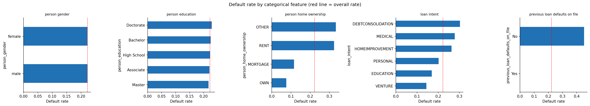
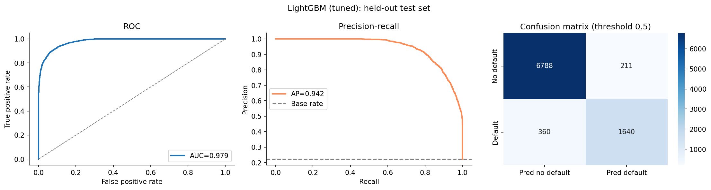
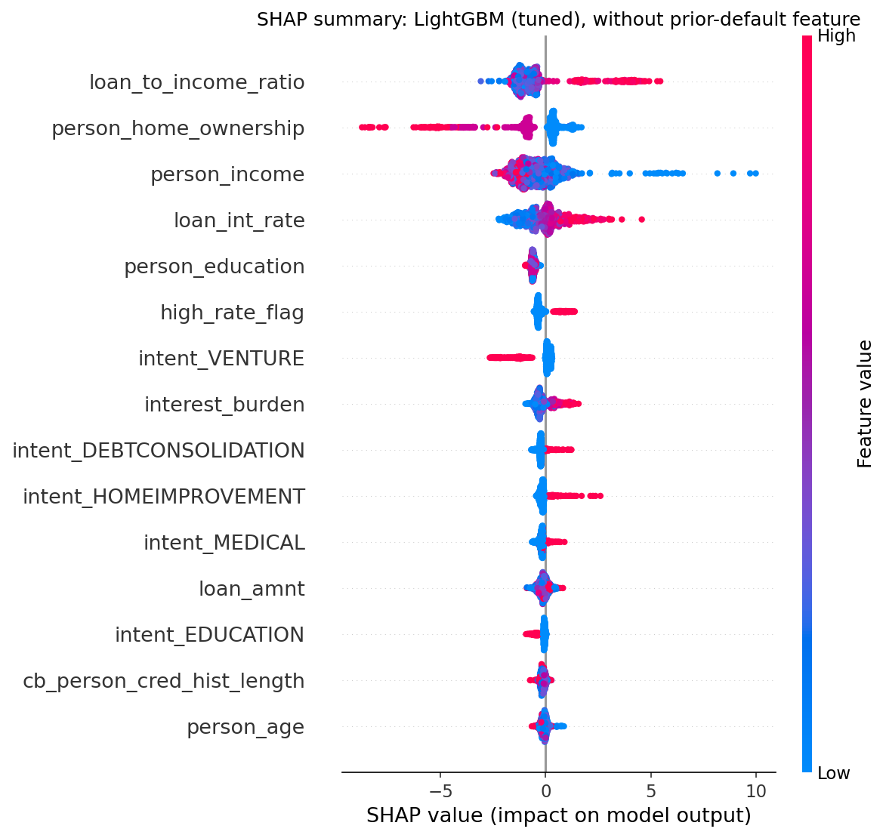

# Explainable Machine Learning for Loan Default Prediction

### A leakage-free model comparison on synthetic credit data, with a data audit, SHAP explanations and a fairness check


**Author:** Junior Owusu Ansah, New Mexico Highlands University · **Data:** [Kaggle: Bank Loan Data](https://www.kaggle.com/datasets/udaymalviya/bank-loan-data) (45,000 synthetic loan applications)

---

## Summary

I compared logistic regression, random forest, XGBoost and LightGBM for predicting loan default. Every step that learns from data (imputation, scaling, SMOTE oversampling) runs inside the cross-validation folds, and gender is kept out of the model.

The most useful result came from auditing the data. **Every one of the 22,856 applicants with a prior default on file is labelled "no default."** That is a rule built into this synthetic dataset, not borrower behaviour, and it alone carries 44% of the model's SHAP importance. So the headline result depends on whether that feature is included:

| Tuned LightGBM, held-out test set (n = 8,999) | ROC-AUC | Avg precision | KS |
|---|---:|---:|---:|
| All features | **0.979** | 0.942 | 0.830 |
| Without the prior-default feature | **0.936** | 0.881 | 0.730 |

The second row is the honest measure of how well income, loan size, interest rate and home ownership predict default here. With the rule feature removed, the drivers are economically sensible: a high loan-to-income ratio, renting, low income and a high interest rate push predictions toward default. The fairness check finds similar error rates for women and men, with an adverse impact ratio of 0.99.

> **Correction (November 2026).** An earlier version of this README reported a cross-validated AUC of 0.994, presented the prior-default pattern as a counterintuitive behavioural finding, and used gender as a model input. The CV score was inflated because SMOTE was applied before cross-validation. The pipeline and this README were rewritten to fix all three.

---

## 1. Data and audit

| Property | Value |
|---|---|
| Rows | 45,000; 7 rows with age above 100 (maximum 144) dropped, leaving 44,993 |
| Features | 13 raw (8 numeric, 5 categorical), plus 8 engineered ratios and flags |
| Target | `loan_status`, treated as 1 = default (22.2%) |
| Origin | Synthetic. Generated with SMOTENC from the older Kaggle *Credit Risk* dataset |

**Why 1 = default.** The two Kaggle pages for this data describe `loan_status` differently (one says 1 = repaid, the original says 1 = approved). The data behaves like the default label of the underlying Credit Risk dataset: applicants with `loan_status = 1` pay higher interest (12.9% vs 10.5%), borrow more relative to income (20% vs 12% of income) and earn less ($59.9k vs $85.6k). Details in [`data/README.md`](data/README.md).

**Artefacts found by the audit** ([`outputs/tables/`](outputs/tables)):

- `previous_loan_defaults_on_file = Yes` → `loan_status = 0` in **100%** of 22,856 cases (51% of the data).
- `credit_score` is unrelated to default: the default rate is 21–22% in every credit-score quintile. In real credit data, credit score is one of the strongest predictors.
- The default rate is the same for women and men (21.8% vs 22.6% in the test set).



## 2. Method

```
raw data → audit → drop age > 100 → row-wise engineered features
        → stratified 80/20 split (gender set aside for the fairness check)
        → imblearn Pipeline per model: median impute → [scale, logistic only] → SMOTE → model
        → 5-fold stratified CV on the training set (all four models)
        → Optuna tuning, 50 trials each, for XGBoost and LightGBM (same leakage-free CV)
        → one evaluation on the held-out test set
        → sensitivity check without the prior-default feature
        → SHAP (TreeExplainer, 1,000 random test applicants) and the gender fairness check
```

- **No leakage.** SMOTE, imputation and scaling are refitted inside every CV fold and never see validation or test rows. The engineered features are row-wise ratios, so creating them before the split leaks nothing.
- **Protected attribute.** `person_gender` is not a model input, because Regulation B (12 CFR 1002) bars lenders from using sex in credit decisions. It is used only to measure outcomes by group.
- **Reproducible.** The seed (42) is fixed, including Optuna's sampler.

## 3. Results

### Cross-validation (training set, 5 folds)

| Model | CV ROC-AUC |
|---|---:|
| Logistic Regression | 0.9559 ± 0.0017 |
| Random Forest | 0.9694 ± 0.0016 |
| XGBoost | 0.9762 ± 0.0017 |
| LightGBM | 0.9773 ± 0.0017 |
| XGBoost (tuned) | 0.9776 |
| LightGBM (tuned) | 0.9787 |

### Held-out test set (n = 8,999, threshold 0.5)

| Model | ROC-AUC | Avg precision | KS | F1 | Recall | Specificity |
|---|---:|---:|---:|---:|---:|---:|
| Logistic Regression | 0.9534 | 0.8582 | 0.7502 | 0.7360 | 0.9080 | 0.8401 |
| Random Forest | 0.9679 | 0.9157 | 0.7808 | 0.8171 | 0.8300 | 0.9424 |
| XGBoost | 0.9761 | 0.9356 | 0.8196 | 0.8447 | 0.8105 | 0.9690 |
| LightGBM | 0.9775 | 0.9386 | 0.8253 | 0.8454 | 0.8095 | 0.9699 |
| XGBoost (tuned) | 0.9780 | 0.9399 | 0.8282 | 0.8501 | 0.8150 | 0.9707 |
| **LightGBM (tuned)** | **0.9789** | **0.9422** | **0.8301** | **0.8517** | 0.8200 | 0.9699 |
| LightGBM (tuned), without prior-default feature | 0.9364 | 0.8810 | 0.7304 | 0.7876 | 0.6980 | 0.9787 |
| LightGBM (tuned), only applicants without a prior default | 0.9389 | 0.9422 | 0.7360 | 0.8517 | 0.8200 | 0.9126 |

- The four gradient-boosted models are within 0.003 AUC of each other, so tuning bought very little.
- Training CV and test scores agree (0.979 vs 0.979). In the earlier, leaky version they disagreed (0.994 vs 0.979).
- The last row evaluates the full model only on the 49% of applicants the synthetic rule does not decide. Its AUC (0.939) matches the model trained without the feature, which confirms that the rule accounts for the gap.



## 4. What drives the predictions (SHAP)

| Rank | All features | Share | Without prior-default feature | Share |
|---:|---|---:|---|---:|
| 1 | `previous_loan_defaults_on_file` | 43.5% | `loan_to_income_ratio` | 15.4% |
| 2 | `loan_to_income_ratio` | 8.3% | `person_home_ownership` | 14.5% |
| 3 | `person_home_ownership` | 7.1% | `person_income` | 11.5% |
| 4 | `person_income` | 7.0% | `loan_int_rate` | 9.7% |
| 5 | `person_education` | 4.3% | `person_education` | 7.6% |

Without the rule feature, the directions are what credit analysts would expect:

- a high loan-to-income ratio and a high interest rate push toward default;
- owning a home or holding a mortgage pushes away from default, and renting pushes toward it;
- low income pushes toward default;
- venture and education loans default less often than debt-consolidation, medical and home-improvement loans.



The [waterfall plot](outputs/figures/fig_shap_waterfall_no_prior_default.png) breaks down the single highest-risk applicant in the sample. A summary plot for the model with all features is also in [`outputs/figures/`](outputs/figures/fig_shap_beeswarm_all_features.png).

## 5. Fairness check by gender

Gender is not a model input. These figures are for the tuned LightGBM on the test set:

| Group | Applicants | Actual default rate | Predicted default rate | True positive rate | False positive rate | AUC | Adverse impact ratio |
|---|---:|---:|---:|---:|---:|---:|---:|
| Female | 4,005 | 21.8% | 20.3% | 81.3% | 3.2% | 0.977 | 1.000 |
| Male | 4,994 | 22.6% | 20.8% | 82.5% | 2.8% | 0.981 | 0.993 |

The adverse impact ratio (each group's approval rate divided by the higher one) is 0.99, far above the 0.80 "four-fifths" threshold. Removing gender as an input does not by itself guarantee fairness, because other features can act as proxies. That is why the outcome check is reported.

## 6. Limitations

- **Synthetic data.** The results describe this generated dataset, not real borrowers. The prior-default rule and the unrelated credit score show that some relationships were not generated realistically.
- **No time dimension.** There are no application dates, so out-of-time validation, the standard test for credit models, is impossible here.
- **Threshold.** Metrics use a 0.5 threshold. A lender would choose the threshold from the cost of a missed default versus a declined good borrower.
- **Calibration.** The probabilities have not been calibrated, so treat them as rankings.
- **One split.** Each result comes from one train/test split. The CV standard deviations (about 0.002) suggest the differences between gradient-boosted models are not meaningful.

## 7. Reproduce

```bash
git clone https://github.com/KwakuJunior7/loan-default-prediction.git
cd loan-default-prediction
python -m venv .venv && .venv\Scripts\activate      # macOS/Linux: source .venv/bin/activate
pip install -r requirements.txt
# download loan_data.csv into data/ (see data/README.md)
python src/pipeline.py              # full run, 50 Optuna trials per model (about an hour on a laptop)
python src/pipeline.py --trials 10  # quicker run
```

Outputs: figures in `outputs/figures/`, every results table in `outputs/tables/`, a machine-readable summary in `outputs/results.json`, and the fitted pipeline in `outputs/models/` (not committed).

## 8. Repository structure

```
loan-default-prediction/
├── data/README.md          download instructions, label notes, known artefacts
├── src/pipeline.py         the full pipeline (sections 1-9)
├── outputs/
│   ├── figures/            EDA, evaluation and SHAP figures
│   ├── tables/             audit, CV, test, SHAP and fairness tables (CSV)
│   └── results.json        all headline numbers
├── requirements.txt
└── README.md
```

## References

- Chawla, N. V., Bowyer, K. W., Hall, L. O., & Kegelmeyer, W. P. (2002). SMOTE: Synthetic minority over-sampling technique. *Journal of Artificial Intelligence Research, 16*, 321–357.
- Chen, T., & Guestrin, C. (2016). XGBoost: A scalable tree boosting system. *Proceedings of the 22nd ACM SIGKDD International Conference on Knowledge Discovery and Data Mining*, 785–794.
- Lundberg, S. M., & Lee, S.-I. (2017). A unified approach to interpreting model predictions. *Advances in Neural Information Processing Systems, 30*.
- Akiba, T., Sano, S., Yanase, T., Ohta, T., & Koyama, M. (2019). Optuna: A next-generation hyperparameter optimization framework. *Proceedings of the 25th ACM SIGKDD International Conference on Knowledge Discovery & Data Mining*, 2623–2631.
- Melsom, B., Vennerød, C. B., de Lange, P. E., Hjelkrem, L. O., & Westgaard, S. (2022). Explainable artificial intelligence for credit scoring in banking. *Journal of Risk*. https://doi.org/10.21314/JOR.2022.011
- Consumer Financial Protection Bureau. Equal Credit Opportunity Act (Regulation B), 12 CFR Part 1002.

## License

[MIT](LICENSE)
